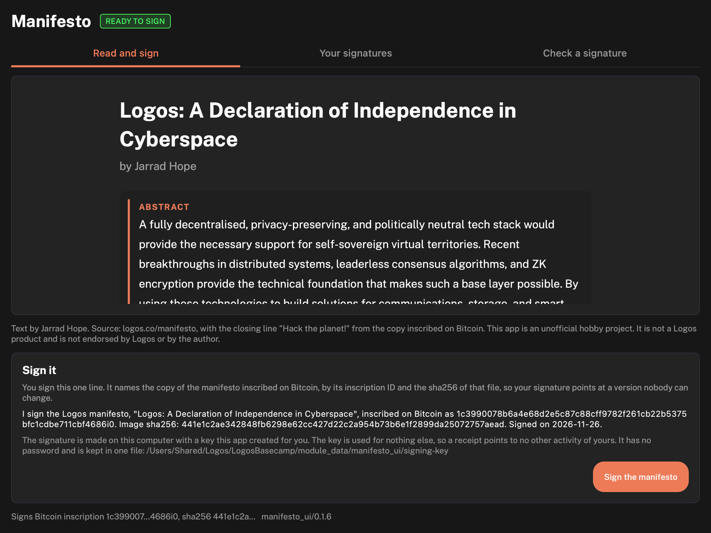

# Manifesto app

> **Disclaimer.** This is a personal, experimental hobby project. It is not an
> official Logos product. Not audited. It is provided as is, with no warranty of
> any kind and no affiliation with or endorsement by any of the projects it
> interoperates with, or by the author of the manifesto. See [Licence](#licence).

An unofficial app for the Basecamp desktop shell. It lets a person read the Logos manifesto and sign
it in one click. The app makes a signing key for itself on first run, so no account is needed. The
result is a small receipt that anyone can check without a server. It is a `ui_qml` module built with
the Logos module builder.

**New here? Follow the [step-by-step guide](docs/INSTALL.md).** It covers installing Basecamp,
adding this app and signing, in plain language. It works on macOS (Apple chip) and Linux desktops
only: not on Windows, Intel Macs, phones or tablets.

The manifesto is "Logos: A Declaration of Independence in Cyberspace" by Jarrad Hope. Source:
<https://logos.co/manifesto>. See [NOTICE.md](NOTICE.md).



## Status

Version 0.1.6, 26 November 2026. This version signs and verifies on one computer and exports the
receipt. There is no shared list of signers yet.

| Platform | State |
|---|---|
| macOS, Apple Silicon | Built, tested headless, and used in Basecamp |
| Linux x86_64 and ARM64 | Built and tested by CI (see the Actions tab for the latest run). An outside tester built it from source on Linux, ran it in Basecamp, signed, and verified the receipt with a separate Ethereum library |
| Intel Macs, phones, tablets | Not supported. Basecamp itself has no build for them |
| Windows | Not supported. The Windows code paths have never been compiled |

Signing and checking are tested end to end (see Tests).

## Install

The full walkthrough, including installing Basecamp itself, is in
[docs/INSTALL.md](docs/INSTALL.md). In short:

1. Install [Logos Basecamp](https://github.com/logos-co/logos-basecamp/releases/latest) 0.3.2 or
   newer.
2. In Basecamp open **Package Manager**, then **Manage Repositories**, and add this catalogue:

   ```
   https://raw.githubusercontent.com/roxanneen/basecamp-apps/main/logos-repo.json
   ```

3. Install **Manifesto** from the Package Manager list. The package is signed by the publisher
   **thehat**, key fingerprint `6AB9 AD2D 6E8D FA6D`; the catalogue has a page at <https://roxanneen.github.io/basecamp-apps/>.
4. Open **Manifesto** and click **Sign the manifesto**.

Without the catalogue: download
[`manifesto_ui.lgx`](https://github.com/roxanneen/Manifesto-app/releases/latest/download/manifesto_ui.lgx)
and use **Install Local Package** in Package Manager. It is the same signed package the catalogue
serves, one file for all three platforms. The app depends on no other module.

The release also carries `manifesto_ui-darwin-arm64.lgx`, `manifesto_ui-linux-x86_64.lgx` and
`manifesto_ui-linux-aarch64.lgx`. Those are the unsigned per-platform builds from CI that the signed
package is made from. Most people should ignore them.

## Releasing a new version

1. Bump `version` in `metadata.json`, push, and wait for the `test` workflow to pass.
2. Publish a GitHub release for the new tag **as a pre-release**. The `release-lgx` workflow attaches
   the three per-platform packages.
3. On the computer that holds the publisher key, run `scripts/release.sh` in
   [roxanneen/basecamp-apps](https://github.com/roxanneen/basecamp-apps). It merges and signs the
   package, updates the catalogue, attaches `manifesto_ui.lgx` to the release and makes the release
   the latest.

Until step 3, the previous version stays the latest release, so the download link in the guide
never points at a release without the signed file.

## What is signed

The app does not sign the whole text. It signs one line that names the manifesto as it is inscribed
on Bitcoin:

```
I sign the Logos manifesto, "Logos: A Declaration of Independence in Cyberspace", inscribed on Bitcoin as 1c3990078b6a4e68d2e5c87c88cff9782f261cb22b5375bfc1cdbe711cbf4686i0. Image sha256: 441e1c2ae342848fb6298e62cc427d22c2a954b73b6e1f2899da25072757aead. Signed on <YYYY-MM-DD>.
```

- **The inscription.** Ordinals inscription 70,614,708, ID `1c3990078b6a4e68d2e5c87c88cff9782f261cb22b5375bfc1cdbe711cbf4686i0`, made in Bitcoin block 841,886 on
  3 May 2024. Its content is a JPEG of the typeset manifesto, 1,781 × 10,807 pixels, 3,969,424 bytes.
- **The hash** is the sha256 of that file, byte for byte. Every signature therefore points at a copy
  nobody can change. Anyone can check it: download the file from an ordinals explorer and hash it.

  ```bash
  curl -sL https://ordiscan.com/content/1c3990078b6a4e68d2e5c87c88cff9782f261cb22b5375bfc1cdbe711cbf4686i0 | shasum -a 256
  ```

  The same file is served by `static.unisat.io/content/<ID>` and, in a browser, by
  `ordinals.com/content/<ID>`. All three gave `441e1c2ae342848f…` on 26 November 2026.
- **The date** is the signer's own statement (UTC). Nothing timestamps it independently.
- **One line** of plain printable text. The app shows it above the Sign button.

Versions 0.1.0 to 0.1.5 signed a different line, naming the sha256 of the app's own text
(`… Text sha256: <64 hex>. Signed on <date>.`). Those receipts still verify, and the app reports them
as signatures of an earlier version.

## The text shown in the app

`src/manifesto.txt` is the manifesto by Jarrad Hope, taken from its source,
<https://logos.co/manifesto>, on 26 November 2026 and checked against the rendered page word for
word: the title, the author, the abstract, the keywords and all 29 body paragraphs are identical and
in the same order. The closing line **"Hack the planet!"**, which the website leaves out, is taken
from the inscribed copy, where it is the last line. The contact line under the author's name
(email, site, PGP) is left out. The line breaks are this app's choice, and the view lays the text out
for reading; neither changes what is signed.

The signature names the inscription, not this file. The app displays the text so people can read
what they sign; the inscription is the reference.

## How a signature is made

On first run the backend takes 32 random bytes from the
operating system, checks they form a usable secp256k1 key, and writes them as hex to
`module_data/manifesto_ui/signing-key` in the Basecamp profile. The file is created owner-only and is
never overwritten: if it cannot be read later, signing switches off and the file is left alone. The
key has no password. It never leaves the backend process and no property, log line or receipt
carries it. Sign builds the statement, signs it (deterministic, RFC 6979), runs the same check a
stranger would run, and saves the receipt.

Back up that file to keep the same signing address on another computer or after a reinstall. Anyone
who can read it can sign the statement as that address, and nothing else: the key is used for
nothing but this.

## The receipt and how to verify it

```json
{
  "type": "logos-manifesto-signature",
  "version": 1,
  "scheme": "eip191",
  "statement": "I sign the Logos manifesto, \"…\", inscribed on Bitcoin as …i0. Image sha256: …. Signed on 2026-11-27.",
  "address": "0x…",
  "signature": "0x…"
}
```

The signature is an Ethereum personal message signature (EIP-191), 65 bytes `r‖s‖v`. To verify:

1. Recover the signer from `signature` and `statement`. Any EIP-191 tool does this, for example
   `cast wallet verify --address <address> "<statement>" <signature>` or
   `eth_account.Account.recover_message`.
2. Compare the result with `address`.
3. Check that the statement names inscription `1c3990078b6a4e68d2e5c87c88cff9782f261cb22b5375bfc1cdbe711cbf4686i0` and sha256 `441e1c2ae342848f…` (see above for
   how to hash the inscribed file yourself).

The app's Check a signature tab does the same three steps on the local machine
(`src/sigcheck.cpp`: Keccak-256, public key recovery through libsecp256k1, EIP-55 addresses).

Receipts often arrive damaged when sent through a chat app or an email: the backslashes before the
quotes in the statement are dropped (so it is no longer valid JSON), quotes turn curly, lines wrap.
The checker therefore also accepts any text that still holds the statement, the address and the
signature, and says when it read a receipt that way. This does not loosen the check: the signature
must still recover to an address that is written in the text, over that exact statement. Text with
no address is refused, because every signature recovers to some address and that alone proves
nothing.

What a valid receipt shows: whoever holds the key for that address signed that exact line. What it
does not show: who the holder is, or that one person signed once. A person can sign with several keys.

Receipts are kept in `module_data/manifesto_ui/receipts/` in the Basecamp profile and go nowhere
until the person copies one out. A receipt points to no other activity of the person's, because
the key does nothing else.

## Build

Requires Nix with flakes.

```bash
nix build .#lgx-portable -o result-lgx-portable   # the installable package
nix build .#ui-dev -o result-ui-dev               # standalone dev host for headless tests
nix build .#test-framework -o result-mcp          # QML inspector client
```

The package lands in `result-lgx-portable/logos-manifesto_ui-module.lgx`; install it as above.

## Tests

`tests/sig_interop.py` (122 checks) holds the C++ signature code to eth-account: Keccak over block
boundaries, recovery for 21 keys in three signature spellings, refusals for a changed text, a flipped
bit and malformed signatures, signatures made in C++ that are byte-identical to eth-account's,
generated keys, and refusal of unusable keys.

```bash
clang++ -std=c++17 -Isrc -I<secp256k1 include> src/sigcheck.cpp tests/sig_host.cpp -L<secp256k1 lib> -lsecp256k1 -o tests/work/sig_host
python3 -m venv tests/.venv && tests/.venv/bin/pip install eth-account
tests/.venv/bin/python tests/sig_interop.py tests/work/sig_host
```

`tests/ui-smoke.mjs` (55 checks, each run from an empty profile) launches the standalone host headless with an isolated profile. It
checks the text, hash and statement in the view; that the app made its key in an owner-only file
and shows it nowhere; that Sign produces one receipt and signing again replaces it; and the Check a
signature tab over the app's own receipt and over receipts made by eth-account
(`tests/make_fixtures.py`): valid, a receipt in the 0.1.0 to 0.1.5 form (naming the text), one
naming another inscribed file, one naming another title, wrong address, edited statement, unrelated
text. It also checks eleven kinds of transit damage that must still verify and twelve altered or
incomplete receipts that must be refused. It then restarts the app three times: the key and receipt survive a restart, a damaged key file
is left untouched with signing off and the receipt still listed, and restoring the file restores the
address. `tests/check_receipt.py` then verifies the receipt the app produced with eth-account.

```bash
tests/.venv/bin/python tests/make_fixtures.py tests/work/fixtures.json
MANIFESTO_RUN=$PWD/result-ui-dev/bin/run-logos-standalone-ui MANIFESTO_WORK=$PWD/tests/work/smoke \
MANIFESTO_FIXTURES=$PWD/tests/work/fixtures.json node tests/ui-smoke.mjs
tests/.venv/bin/python tests/check_receipt.py tests/work/smoke/signed-receipt.json \
  tests/work/smoke/home/basecamp/module_data/manifesto_ui/signing-key
```

Remove `tests/.venv` before a Nix build: a path flake copies the whole folder into the store.

Environment hook used by tests only: `MANIFESTO_DATE` pins the date in the statement.

## Not in this version

- A shared list of signers. The plan is to publish receipts on a Logos Messaging topic through
  `delivery_module`, have every copy of the app verify each one before counting it, and publish
  snapshots of the list to Logos Storage.
- One signature per person. A key costs nothing to make, so a count of receipts is a count of keys.
- Signing with an existing wallet account or a hardware key. An earlier build could use accounts
  from Basecamp's Signer app; that was removed so the app depends on nothing else.
- A password or hardware protection for the app's own key, and a way to export or replace it from
  the view.

## Licence

The code is licensed under MIT or Apache-2.0, at your option. The manifesto text is not covered by
those licences; see [NOTICE.md](NOTICE.md).
